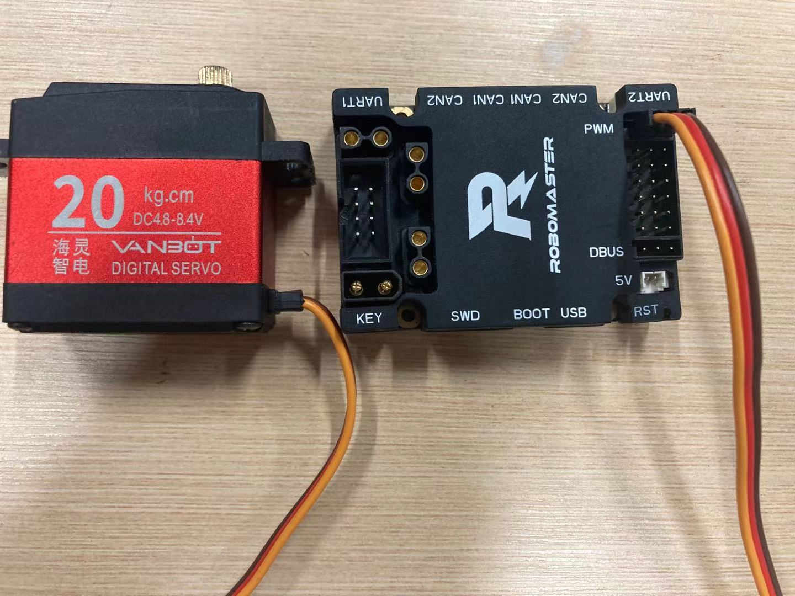
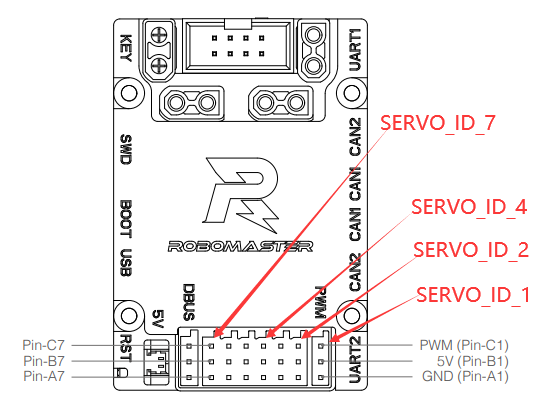

# 零基础接线入门（先看懂再看口，别直接插）

## 一、只有六个东西，各自干一件事

| 东西 | 一句话职责 | 长相 |
|---|---|---|
| **电池 TB47S** | 提供 24 V 能量 | 黑方砖，上面一个圆形按键 + 4 个灯 |
| **电池架** | 把电池变成 **XT60 插头**，并给一个总开关 | 黑色小板，插电池用 |
| **C 板（开发板 C 型）** | **大脑**：跑我们的代码、发指令、读传感器 | 黑色小板，很多白色小插座，丝印写着 UART/CAN/PWM/DBUS |
| **电调 C620** | **翻译官**：把 C 板给的"电流数字"变成三相电去驱动电机 | 小黑盒，一头接电池、一头接电机、一根 CAN 线 |
| **电机 M3508** | **肌肉**：转 | 圆柱 + 减速箱，带三根粗线和一根 7 芯细线 |
| **遥控器 + 接收机** | **方向盘**：人给的输入 | 遥控器像游戏手柄；接收机是一个小方块 |

还有两个"辅助工具"，不是车的一部分：

| 东西 | 职责 |
|---|---|
| **ST-Link** | 把电脑里的程序**灌进** C 板（烧录） |
| **micro USB 线** | 让 C 板和电脑**说话**（看打印） |

## 二、能量流和数据流（记住这两条线就够）

```
能量：  电池 ──XT30──► C 板 24V IN ──► C 板 24V OUT ──► 电调 ──三相线──► 电机
                             │(只给板子自己供电)
数据：  电脑 ──micro USB──► C 板 ──CAN 线──► 电调 ──7芯线──► 电机（回传转速）
        遥控器 ~~2.4G~~► 接收机 ──DBUS 线──► C 板
```

**能量是"粗线、大电流"，数据是"细线、小电流"**，两类线永远不要接错——这是唯一需要记的原则。

## 三、C 板上每个口是干什么的（对着板子看丝印）



| 丝印 | 接什么 | 什么时候用 |
|---|---|---|
| **USB**（小方口，micro USB）| 电脑 | **第一步就用它**：供电 + 看打印 |
| **SWD**（4 针）| ST-Link | 烧录程序 |
| **CAN1**（2 针）| 电调 CAN 口 | 控制电机 |
| **CAN2**（4 针）| 别的 CAN 设备 | 暂时不用 |
| **PWM**（一排针）| 舵机 | 驱动机械臂 |
| **DBUS** | 遥控器接收机 | 接遥控 |
| **5V** | 5 V 输出 | 暂时不用 |
| **UART1 / UART2** | 串口设备（裁判系统等）| 以后 |
| **KEY** | 板载按键 | 按一下看灯变化 |
| **BOOT / RST** | 烧录模式 / 复位 | 救砖时用 |
| **24V IN / 24V OUT**（XT30 插头）| 电池 / 电调 | 需要动力时才接 |

PWM 座（接舵机）的针位官方画过：



## 四、第一次接线：只插一根线，零风险

**只插 micro USB 线**（C 板 → 电脑），别的什么都不要接。

- C 板会自己上电（手册写明：USB 能驱动 STM32 和板载外设，**但带不动 PWM 那一路**）
- 你会看到：RGB 灯开始变色；电脑多出一个 COM 口
- 跑 `python tools\read_serial.py`，应该看到 `gx=… vbat=…` 滚动

**这一根线就够你完成 R0–R7 的全部学习**（打印、IMU、标定、滤波都在板载上，不需要电池、不需要电机）。

### 加第二根：ST-Link（4 根线，3.3 V）

```
ST-Link  3.3V ●───────● 3.3V  ┐
         SWDIO ●──────● SWDIO │  C 板 SWD（J8）
         SWCLK ●──────● SWCLK │  丝印 A/B/C/D 或看手册
         GND   ●──────● GND   ┘
```

⚠️ **只接 3.3 V，绝不接 5 V** —— 5 V 会打穿 STM32 的 IO。

### 加第三根：电池（2 个 XT30）

```
电池架 XT60 ──(XT60转XT30线)──► C 板 24V IN
C 板 24V OUT ──────────────► 电调 XT30        ← 第四步才接
```

XT30 是**有方向的插头**，插不进就是反了，别硬怼。

### 加第四组：电调 + 电机（三组线）

```
① 电调 7 芯线 ──► 电机 7 芯线        必接（编码器，电机靠它被"看见"）
② 电调 CAN 口 ──► C 板 CAN1（2 针）  必接 黑=CAN_L(1) 红=CAN_H(2)
③ 电调 三相线 ──► 电机 三相线        第一步先拔掉！电机就转不起来，最安全
```

## 五、三条铁律

1. **一次只加一根线，加完测一遍。** 三根一起插，出问题你不知道是哪根。
2. **所有插头都防插反**：有卡扣、有方向、颜色匹配（三相线同色对接）。插不进去 = 方向错，不是力气不够。
3. **接电之前先用万用表"蜂鸣档"测通断**：两根表笔分别戳你要接的两个点，响 = 通。测 XT30 的正负之间**不应该响**（响了就是短路）。

## 六、万用表怎么用（只会一档就够）

- 旋钮转到 **蜂鸣档**（🔊 或 二极管符号）
- 两支表笔互碰 → 响，说明档对了
- 测导线：一头一根，响 = 这根线是通的
- 测短路：电池插头正极对负极，**不响才对**（响了千万别上电）
- 测电压：转到 **直流 20 V 或 200 V 档**，红笔正黑笔负 —— 这一步第五次接线才用

## 七、顺序总结（贴墙上）

```
1. micro USB          零风险，板子活、串口出数       ← 今晚到这里就够了
2. + ST-Link          能烧录（只接 3.3V）
3. + 电池 XT30        板子由电池供电（串口还能看）
4. + 电调 CAN         手转电机轴，串口能读转速
5. + 三相线           电机才可能真转（要垫起来/夹住）
6. + 接收机 DBUS      遥控才通
7. + 舵机 PWM         机构才动
```

**任何一步不成功，就退回到上一步**——上一步是好的，说明问题在这一步新加的东西上。
